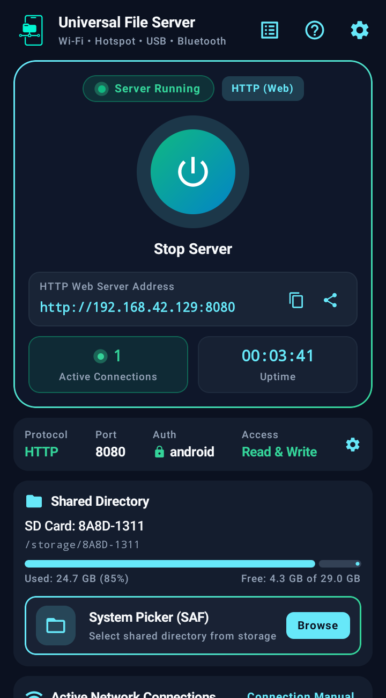
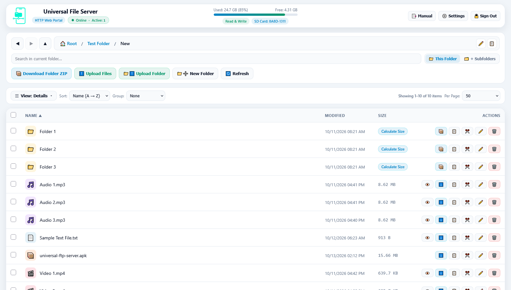

  

  # Universal File Server

  ### سرور بومی، چندپروتکلی و پرسرعت انتقال فایل اندروید (HTTP Web Portal، FTP و SFTP) از طریق کابل USB، هات‌اسپات، وای‌فای و بلوتوث
  **Native High-Speed Multi-Protocol Android File Server (HTTP Web Portal, FTP & SFTP) over USB Tethering, Hotspot, Wi-Fi & Bluetooth PAN**

  

    
    
    
    
    
    
  

   

  
  

---

# 🇮🇷 بخش فارسی (Persian)

## 📖 درباره برنامه

**Universal File Server** یک نرم‌افزار متن‌باز، بومی (Native)، بسیار سبک و پیشرفته برای سیستم‌عامل اندروید است که گوشی یا تبلت شما را به یک سرور چندپروتکلی، فوق‌سریع و امن برای مدیریت و انتقال فایل تبدیل می‌کند. این برنامه با استفاده از **Google AI Studio** و بر پایه معماری مدرن اندروید (**Kotlin** و **Jetpack Compose Material 3**) طراحی و پیاده‌سازی شده است.

این برنامه امکان انتقال فایل را به‌صورت **کاملاً آفلاین** و بدون نیاز به اینترنت، کابل‌های اختصاصی، برنامه‌های ابری یا نصب هرگونه نرم‌افزار جانبی روی کامپیوتر فراهم می‌سازد. تنها با باز کردن یک آدرس در مرورگر وب هر دستگاهی (کامپیوتر، لپ‌تاپ، مک، لینوکس، تلویزیون هوشمند یا گوشی دیگر) یا از طریق کلاینت‌های استاندارد FTP و SFTP، می‌توانید به تمام فایل‌های دستگاه خود دسترسی داشته باشید.

---

## ✨ امکانات و قابلیت‌های کلیدی

### ۱. موتور سرور سه‌گانه (Triple Protocol Engine)

#### 🌐 پرتال وب پیشرفته HTTP (پورت پیش‌فرض ۸۰۸۰ - حالت پیش‌فرض):
یک فایل منیجر مدرن، واکنش‌گرا و غنی مشابه **Windows Explorer** که مستقیماً درون مرورگر اجرا می‌شود:
* **۷ حالت نمایش متنوع (Layout Views):**
  * آیکون‌های بسیار بزرگ (*Extra large icons*)
  * آیکون‌های بزرگ (*Large icons*)
  * آیکون‌های متوسط (*Medium icons*)
  * آیکون‌های کوچک (*Small icons*)
  * حالت فشرده فهرستی (*List*)
  * حالت جزئیات جدولی (*Details - حالت پیش‌فرض*)
  * حالت کاشی‌ها (*Tiles*)
* **زوم روان با اسکرول ماوس:** تغییر آنی و پیوسته بین ۷ حالت نمایش با نگه‌داشتن <kbd>Ctrl</kbd> و چرخاندن اسکرول ماوس.
* **پیش‌نمایش بندانگشتی تصاویر و ویدیوها (Media Thumbnails):** کلید فعال/غیرفعال‌سازی لود بندانگشتی رسانه‌ها همراه با سیستم کش چندسطحی در رم دستگاه.
* **پنجره پیش‌نمایش شناور (Pop-Out Floating Window):** امکان جدا کردن مدال پیش‌نمایش عکس، فیلم، آهنگ یا متن و تبدیل آن به یک پنجره شناور با ۸ دستگیره تغییر ابعاد (Resize) که هنگام گردش بین پوشه‌ها باز و در حال پخش باقی می‌ماند.
* **دانلود آنی پوشه‌ها بدون اشغال حافظه (Zero-Storage ZIP Streaming):** فشرده‌سازی و استریم مستقیم پوشه‌ها یا فایل‌های انتخابی به‌صورت فایل ZIP از طریق شبکه، بدون اشغال حافظه موقت روی گوشی.
* **آپلود پوشه‌های تودرتو و Drag & Drop:** کشیدن و رها کردن فایل‌ها و ساختار کامل پوشه‌ها از کامپیوتر به داخل مرورگر.
* **کشیدن فایل به خارج از مرورگر (Drag-Out to OS):** امکان کشیدن فایل‌ها از مرورگر و رها کردن مستقیم آن‌ها روی دسکتاپ یا File Explorer ویندوز.
* **Drag & Drop داخلی بین پوشه‌ها:** کشیدن آیتم‌ها و رها کردن روی پوشه‌های مقصد یا بردکرامب‌ها جهت انتقال آسان.
* **انتخاب مستطیلی با ماوس (Marquee Rubber-Band Selection):** کلیک و کشیدن کادر انتخاب روی صفحه با قابلیت اسکرول خودکار هنگام رسیدن به لبه‌های پنجره.
* **پرش کیبوردی هوشمند (Type-Ahead Jump):** تایپ سریع حروف ابتدایی نام فایل با کیبورد برای پرش مستقیم به آن همراه با نشانگر شناور وضعیت.
* **تغییر نام دسته‌جمعی متوالی (Batch Sequential Rename):** تغییر نام گروهی فایل‌ها با استایل‌های مختلف شماره‌گذاری (`(1)`، `_01`، `_001`، `-001` و...)، حفظ پسوندها و پیش‌نمایش زنده.
* **مدیریت هوشمند تداخل نام (Conflict Resolution):** پنجره‌های تعاملی برای تصمیم‌گیری در صورت وجود فایل همنام (جایگزینی Overwrite، رد کردن Skip، شماره‌گذاری خودکار Auto-Number یا نام دلخواه).
* **پیوند با کلیپ‌بورد سیستم‌عامل (OS Clipboard Paste):** فشردن <kbd>Ctrl + V</kbd> در مرورگر برای آپلود مستقیم تصاویر و فایل‌های کپی‌شده در ویندوز.
* **محاسبه بازگشتی حجم پوشه‌ها (On-Demand Folder Size):** کلیک روی دکمه محاسبه حجم برای نمایش دقیق حجم، تعداد فایل‌ها و تعداد زیرپوشه‌ها.
* **جستجوی عمیق و بازگشتی:** جستجو در پوشه فعلی یا اسکن سراسری تمام زیرپوشه‌ها با نتایج لحظه‌ای.
* **منوهای راست‌کلیک متنی (Context Menus):** منوهای اختصاصی روی آیتم‌ها و فضای خالی با زیرمنوهای شناور (Cascading Submenus).
* **ذخیره خودکار تنظیمات:** ماندگاری تم، اندازه صفحه، نوع چیدمان و ترتیب مرتب‌سازی در کوکی مرورگر.

#### ⚡ پروتکل استاندارد FTP (پورت پیش‌فرض ۲۱۲۱):
* منطبق با استانداردهای RFC 959 با پشتیبانی از دستورات نوین `MLSD`، `MLST`، `SIZE`، `MDTM` و `UTF8`.
* پشتیبانی کامل از حالت‌های Passive (تخصیص پورت پویا) و Active Mode (`PORT` / `EPRT`).
* سازگاری کامل با Windows File Explorer (افزودن به عنوان Network Location)، تلویزیون‌های هوشمند، کنسول‌ها و رسیورها.

#### 🔒 پروتکل امن SFTP بر بستر SSH (پورت پیش‌فرض ۲۲۲۲):
* توسعه‌یافته با کتابخانه قدرتمند **Apache Mina SSHD 2.12.1**.
* ساخت زوج‌کلید اختصاصی ۲۰۴۸ بیتی RSA در حافظه رم جهت جلوگیری از کرش‌های ذخیره‌سازی اندروید.
* رمزنگاری کامل سرتاسری و سازگاری بی‌نقص با کلاینت‌های حرفه‌ای نظیر FileZilla، WinSCP و Termius.

---

### ۲. چهار بستر اتصال شبکه کاملاً آفلاین
* 🔌 **کابل USB (USB Tethering):** بالاترین پهنای باند و سرعت انتقال (مناسب بک‌آپ‌های سنگین چندده گیگابایتی) بدون مصرف اینترنت.
* 📶 **هات‌اسپات گوشی (Mobile Hotspot):** راه‌اندازی شبکه بی‌سیم محلی مستقل توسط خود گوشی بدون نیاز به مودم خانگی.
* 🌐 **وای‌فای مشترک (Local Wi-Fi):** اشتراک‌گذاری سریع فایل بین دستگاه‌های متصل به مودم یا روتر خانگی/اداری.
* 🔵 **شبکه بلوتوث (Bluetooth PAN):** انتقال فایل از طریق اشتراک شبکه بلوتوث با مصرف انرژی ناچیز در مواقع اضطراری.
* 🛡 **جداسازی و ایزولاسیون امنیتی:** فیلتر خودکار و رد درخواست‌ها از روی دیتای سیم‌کارت (Cellular LTE/5G) و کانکشن‌های VPN جهت حفظ امنیت و جلوگیری از هدررفت حجم اینترنت.

---

### ۳. مدیریت پیشرفته حافظه و مجوزها
* 📱 **پشتیبانی کامل از حافظه داخلی و رم‌های جانبی:** شناسایی خودکار کارت‌های حافظه جانبی (MicroSD) و حافظه‌های فلش USB OTG.
* 📂 **انتخابگر رسمی پوشه (Android SAF System Picker):** امکان محدود کردن و ایزوله ساختن سرور به یک پوشه مشخص بدون نیاز به باز کردن دسترسی کل حافظه.
* 🛡 **حالت فقط‌خواندنی (Read-Only Mode):** مسدودسازی عملیات آپلود، حذف، ویرایش یا تغییر نام برای حفظ امنیت فایل‌ها.
* 📦 **سازگاری با اندروید ۱۱ تا ۱۶:** راهنمای داخلی فعال‌سازی مجوز مدیریت کلی فایل‌ها (`MANAGE_EXTERNAL_STORAGE`).

---

### ۴. رابط کاربری و عملکرد در پس‌زمینه
* 🎨 **طراحی مدرن Jetpack Compose:** تم تاریک و روشن هماهنگ با تم سیستم یا انتخاب دستی.
* 🔋 **سرویس پیش‌زمینه (Foreground Service):** حفظ فعال بودن سرور هنگام بستن یا مینیمایز کردن برنامه با دکمه توقف در نوار اعلان.
* ⚡ **قفل بیداری دوگانه (WakeLock & WifiLock):** جلوگیری از به خواب رفتن CPU و قطع شدن ارتباط وای‌فای در زمان قفل بودن صفحه.
* 📊 **آمار زنده و لاگ‌های سیستمی:** نمایش شمارنده زنده اتصالات، مدت زمان روشن بودن (Uptime)، نوار وضعیت حافظه و لاگ‌های کامل با قابلیت کپی.

---

## ⌨️ کلیدهای میانبر در پرتال وب (Web Portal Shortcuts)

| کلید میانبر | عملکرد |
| :--- | :--- |
| <kbd>کلیک و درگ ماوس</kbd> | انتخاب مستطیلی آیتم‌ها (Rubber-Band Marquee) |
| <kbd>Ctrl + کلیک</kbd> | افزودن / حذف آیتم مشخص از لیست انتخاب |
| <kbd>Shift + کلیک</kbd> | انتخاب بازه‌ای پیوسته از آیتم‌ها |
| <kbd>Ctrl + A</kbd> | انتخاب تمامی فایل‌ها و پوشه‌ها |
| <kbd>A</kbd> تا <kbd>Z</kbd> / <kbd>0</kbd> تا <kbd>9</kbd> | پرش کیبوردی سریع به فایل شروع‌شونده با آن حرف (Type-Ahead) |
| <kbd>Ctrl + اسکرول ماوس</kbd> | جابه‌جایی و زوم پیوسته میان ۷ حالت نمایش (View Modes) |
| <kbd>Alt + V</kbd> یا <kbd>Alt + Shift + 6</kbd> | چرخش بین حالت‌های نمایش مختلف |
| <kbd>Ctrl + C</kbd> / <kbd>Ctrl + X</kbd> | کپی یا کات (انتقال) آیتم‌های انتخاب‌شده |
| <kbd>Ctrl + V</kbd> | پیست کردن آیتم‌های داخلی یا آپلود مستقیم فایل‌های کلیپ‌بورد سیستم‌عامل |
| <kbd>F2</kbd> | تغییر نام تکی یا تغییر نام دسته‌جمعی متوالی (Batch Rename) |
| <kbd>Delete</kbd> | حذف دائمی آیتم‌های انتخاب‌شده |
| <kbd>Alt + Enter</kbd> | نمایش مشخصات کامل، حجم و متادیتای آیتم یا پوشه (Properties) |
| <kbd>Alt + P</kbd> | باز / بسته کردن پیش‌نمایش فایل |
| <kbd>Alt + N</kbd> یا <kbd>Ctrl + Shift + N</kbd> | ساخت پوشه جدید |
| <kbd>Alt + ←</kbd> / <kbd>Alt + →</kbd> | بازگشت به پوشه قبلی یا رفتن به پوشه بعدی (History) |
| <kbd>Alt + ↑</kbd> | رفتن به پوشه والد (یک سطح بالاتر) |
| <kbd>Ctrl + F</kbd> یا <kbd>F3</kbd> | رفتن به کادر جستجو |
| <kbd>F5</kbd> | بارگذاری مجدد لیست فایل‌ها (Refresh) |
| <kbd>Esc</kbd> | لغو انتخاب، بستن منوها یا بستن پنجره‌های باز |
| <kbd>?</kbd> یا <kbd>F1</kbd> | باز کردن راهنمای تعاملی و دفترچه راهنما |

---

## 🛠 پشته فنی (Tech Stack)

* **محیط توسعه و طراحی:** [Google AI Studio](https://aistudio.google.com/)
* **زبان برنامه‌نویسی:** Kotlin 2.2.10
* **کیت رابط کاربری:** Jetpack Compose (Material 3)
* **موتور SSH/SFTP:** Apache Mina SSHD 2.12.1
* **حداقل نسخه اندروید:** Android 7.0 (API 24)
* **نسخه هدف اندروید:** Android 16 (API 36)
* **نیازمندی ساخت:** Android Studio Ladybug (2024.2+) و JDK 17+

---

 

# 🇬🇧 English Section

## 📖 About The App

**Universal File Server** is an open-source, native, lightweight, and modern Android application that turns any device into a robust, high-speed, multi-protocol file server. Built using **Google AI Studio** and architected with cutting-edge Android development practices (**Kotlin** and **Jetpack Compose Material 3**).

It enables completely offline, ultra-fast file management and transfers without third-party desktop client installations, cloud services, or internet access. Access and manage your phone's storage from any desktop or mobile browser via its rich **HTTP Web Portal**, or connect using dedicated **FTP** and **SFTP** clients.

---

## ✨ Key Features

### 1. Triple Protocol Engine

#### 🌐 Desktop-Class HTTP Web Portal (Default Port `8080`):
A full-featured, responsive, Windows Explorer-like web application served directly from your Android device:
* **7 Versatile Layout Views:**
  * *Extra large icons*
  * *Large icons*
  * *Medium icons*
  * *Small icons*
  * *List* (compact multi-column view)
  * *Details* (standard sortable table - default)
  * *Tiles* (media card summary)
* **Ctrl + Wheel Zoom:** Smoothly cycle through all 7 layout modes using <kbd>Ctrl</kbd> + Mouse Wheel.
* **Thumbnail Previews:** Toggle on-the-fly thumbnail generation for photos and videos, powered by in-memory caching and Android `MediaMetadataRetriever`.
* **Pop-Out Floating Preview Window:** Dock or pop out media/text previews into a persistent, draggable, and 8-way resizable floating window that remains active while browsing directories.
* **Zero-Storage ZIP Streaming:** Download full folders or multi-selected files on-the-fly as compressed `.zip` archives with zero temporary disk usage on the phone.
* **Bidirectional Drag & Drop:**
  * Upload nested directory trees from desktop to browser.
  * Drag files from the browser directly to Windows Explorer or Desktop.
  * Drag items internally onto subfolders or breadcrumbs to move them.
* **Mouse Marquee (Rubber-Band) Selection:** Click and drag a selection rectangle across items with automatic viewport edge scrolling.
* **Type-Ahead Keyboard Navigation:** Type any letter on your keyboard to instantly jump to matching files and folders with visual status feedback.
* **Batch Sequential Rename:** Bulk rename files with numbering styles (`(1)`, `_01`, `_001`, `-001`, ` 1`), start indexes, extension preservation, and live old-to-new previews.
* **Smart Conflict Resolution:** Interactive modals to handle duplicate filenames during upload, move, or rename (Overwrite, Skip, Auto-Number, or Custom Name).
* **OS Clipboard File Paste (<kbd>Ctrl + V</kbd>):** Paste files or screenshots copied from your computer directly into the active folder.
* **On-Demand Recursive Folder Size:** Calculate total bytes, file counts, and subfolder counts recursively for any directory.
* **Deep Recursive Search:** Filter the active folder or recursively scan all subdirectories.
* **Context Menus:** Right-click context menus for items and background with cascading submenus.
* **Preference Persistence:** Theme, layout, thumbnail toggles, sort options, and page sizes persist across visits in browser cookies.

#### ⚡ Standard RFC 959 FTP (Default Port `2121`):
* Standards-compliant FTP server supporting `MLSD`, `MLST`, `SIZE`, `MDTM`, `REST`, and `UTF8`.
* Full Passive Mode (ephemeral port allocation) and Active Mode (`PORT` / `EPRT`) support.
* Direct integration with Windows File Explorer ("Add a network location"), smart TVs, and media players.

#### 🔒 Encrypted SFTP over SSH (Default Port `2222`):
* Powered by **Apache Mina SSHD 2.12.1**.
* In-memory 2048-bit RSA key generation prevents Android storage serialization crashes.
* Full end-to-end encryption for professional clients such as FileZilla, WinSCP, and Termius.

---

### 2. Four Offline Network Modes
* 🔌 **USB Tethering:** Maximum physical cable transfer speeds for multi-gigabyte transfers and backups without a router or data usage.
* 📶 **Mobile Hotspot (Wi-Fi AP):** Create an instant wireless network directly on your phone when no local router is available.
* 🌐 **Local Wi-Fi:** Seamless file transfers across all computers and phones connected to the same Wi-Fi router.
* 🔵 **Bluetooth Network (PAN):** Low-power wireless file access over Bluetooth tethering.
* 🛡 **Cellular & VPN Isolation:** Automatically rejects mobile cellular data (LTE/5G) and VPN traffic to safeguard security and avoid data consumption.

---

### 3. Smart Storage & Permission Management
* 📱 **Internal Storage & External Media:** Instant access to internal storage, SD Cards, and USB OTG drives.
* 📂 **Storage Access Framework (SAF):** Restrict server scope to an isolated custom directory using Android's system folder picker.
* 🛡 **Read-Only Mode:** Protect files by disabling upload, rename, delete, and overwrite operations.
* 📦 **Android 11–16 Ready:** Built-in guidance for granting All Files Access (`MANAGE_EXTERNAL_STORAGE`).

---

### 4. Background Reliability & Architecture
* 🔋 **Foreground Service:** Persistent status bar notification keeps the server alive when minimized.
* ⚡ **Dual Lock (WakeLock & WifiLock):** Prevents CPU sleep states and Wi-Fi disconnects during transfers while the screen is locked.
* 📊 **Live Telemetry & Diagnostics:** Real-time active connection counts, uptime timer, storage indicators, and detailed activity logs.

---

## ⌨️ Web Portal Keyboard Shortcuts

| Shortcut | Action |
| :--- | :--- |
| <kbd>Click & Drag</kbd> | Rubber-band selection box (Marquee) |
| <kbd>Ctrl + Click</kbd> | Toggle item in selection |
| <kbd>Shift + Click</kbd> | Contiguous range selection |
| <kbd>Ctrl + A</kbd> | Select all items in folder |
| <kbd>A</kbd>–<kbd>Z</kbd> / <kbd>0</kbd>–<kbd>9</kbd> | Type-ahead jump to matching file |
| <kbd>Ctrl + Mouse Wheel</kbd> | Cycle across 7 layout view modes |
| <kbd>Alt + V</kbd> or <kbd>Alt + Shift + 6</kbd> | Switch to next view mode |
| <kbd>Ctrl + C</kbd> / <kbd>Ctrl + X</kbd> | Copy / Cut selected items |
| <kbd>Ctrl + V</kbd> | Paste staged items or upload OS clipboard files |
| <kbd>F2</kbd> | Rename single item or open Batch Rename modal |
| <kbd>Delete</kbd> | Delete selected items |
| <kbd>Alt + Enter</kbd> | Open Properties & storage metadata modal |
| <kbd>Alt + P</kbd> | Toggle file preview modal |
| <kbd>Alt + N</kbd> or <kbd>Ctrl + Shift + N</kbd> | Create new folder |
| <kbd>Alt + ←</kbd> / <kbd>Alt + →</kbd> | History backward / forward |
| <kbd>Alt + ↑</kbd> | Navigate up to parent folder |
| <kbd>Ctrl + F</kbd> or <kbd>F3</kbd> | Focus search input |
| <kbd>F5</kbd> | Refresh file list |
| <kbd>Esc</kbd> | Clear selection or dismiss modals |
| <kbd>?</kbd> or <kbd>F1</kbd> | Open Manual & Shortcuts guide |

---

## 🛠 Tech Stack & Prerequisites

* **Development Tool:** [Google AI Studio](https://aistudio.google.com/)
* **Programming Language:** Kotlin 2.2.10
* **UI Framework:** Jetpack Compose (Material 3)
* **SSH/SFTP Engine:** Apache Mina SSHD (2.12.1)
* **Minimum SDK:** Android 7.0 (API 24)
* **Target SDK:** Android 16 (API 36)
* **Build Requirements:** Android Studio Ladybug (2024.2+) & JDK 17+
